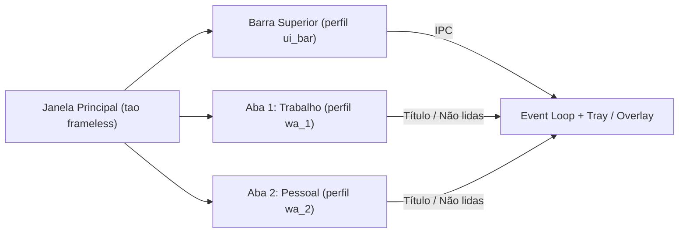

<div align="center">

# RustZapp

**Navegador ultraleve em Rust exclusivo para múltiplos WhatsApp Web com sessões e cookies independentes.**

[](https://www.rust-lang.org/)
[](https://github.com/tauri-apps/wry)
[](https://developer.microsoft.com/en-us/microsoft-edge/webview2/)
[](#como-compilar-e-executar)
[](#como-funciona-o-isolamento)

</div>

---

## Sobre o projeto

O **RustZapp** (`WhatsAppBrowser.exe`) é um navegador desktop minimalista feito em **Rust** que faz uma única coisa: **abrir diretamente o WhatsApp Web** com suporte a **várias abas simultâneas**, cada uma com **cookies, LocalStorage, IndexedDB e cache totalmente isolados**.

Sem Electron, sem Node.js e sem empacotar um Chromium inteiro — ele usa o **Microsoft Edge WebView2** nativo do Windows, gerando um executável único de menos de **1 MB** com inicialização instantânea.

---

## Principais recursos

- **Abertura direta e exclusiva no WhatsApp Web**: abre imediatamente em `https://web.whatsapp.com/`, bloqueando navegação para domínios externos e bloqueando pop-ups.
- **Múltiplas contas com cookies independentes**: cada aba recebe um perfil isolado do WebView2 (`wa_1`, `wa_2`, ...), permitindo conectar vários números de WhatsApp na mesma janela sem conflito de sessão.
- **Barra de título customizada (frameless)**: remove a barra padrão do Windows e integra na mesma faixa de `40px`:
  - Ícone do aplicativo + área arrastável (com duplo clique para maximizar/restaurar e redimensionamento pelas bordas).
  - Abas roláveis com indicador visual de aba ativa.
  - Botões de **Nova aba (`+`)**, **Recarregar (`↻`)**, **Minimizar**, **Maximizar/Restaurar** e **Fechar**.
- **Renomear abas**: clique duplo no nome da aba para personalizar (ex.: `Trabalho`, `Pessoal`, `Suporte`).
- **Contador de notificações em tempo real**:
  - Badge verde por aba na barra superior.
  - Soma total no título da janela.
  - **Badge vermelho numérico** sobre o ícone na barra de tarefas padrão do Windows (`ITaskbarList4::SetOverlayIcon`).
  - **Ícone dinâmico na bandeja do sistema** (`Shell_NotifyIconW`), exibindo o contador ao vivo inclusive na barra [**WinRust (`topbar`)**](https://github.com/Lemxy/WinRust).
- **Persistência automática**: suas abas abertas, nomes personalizados e logins (QR Code) permanecem salvos entre reinicializações.
- **Instância única amigável**: se o diretório de sessão já estiver em uso, restaura e foca a janela já aberta em vez de duplicar processos.

---

## Como usar

| Ação | Como fazer |
| :--- | :--- |
| **Abrir nova conta WhatsApp** | Clique no botão **`+`** na barra superior |
| **Alternar entre contas** | Clique na aba desejada |
| **Renomear aba** | **Clique duplo** no nome da aba e pressione `Enter` |
| **Fechar aba** | Clique no **`×`** da aba (ao fechar a última, uma nova aba limpa é criada) |
| **Recarregar aba ativa** | Clique no botão **`↻`** |
| **Mover / Maximizar janela** | Arraste pela área vazia da barra superior (duplo clique maximiza/restaura) |
| **Fixar contador na barra WinRust (`topbar`)** | Abra o chevron **`^`** da bandeja e clique com o **botão do meio** no ícone do RustZapp |

---

## Como funciona o isolamento

Todas as WebViews compartilham um único `WebContext` (otimizando memória e processos), mas cada aba é instanciada com um `profile_name` exclusivo no WebView2 (`wa_1`, `wa_2`, ...). Ao criar uma nova aba, o identificador incremental é salvo em `tabs.json`, garantindo que abas novas nunca herdem cookies de abas fechadas anteriormente.



---

## Estrutura do projeto

| Arquivo | Responsabilidade |
| :--- | :--- |
| [`src/main.rs`](src/main.rs) | Janela sem bordas (`tao`), criação das WebViews (`wry`), bloqueio de URLs/pop-ups, controle de abas, `TrayIcon` Win32 e instância única |
| [`src/config.rs`](src/config.rs) | Persistência em `tabs.json`, gerenciamento de perfis, parser de não lidas e allowlist de URLs |
| [`src/tab_bar.rs`](src/tab_bar.rs) | Barra superior HTML/CSS/JS autocontida com tema escuro do WhatsApp e comunicação IPC |
| [`src/badge.rs`](src/badge.rs) | Renderizador RGBA `32×32` em Rust puro para o ícone base da bandeja e badges numéricos (`1`–`99+`) |
| [`build.rs`](build.rs) | Embute `assets/icon.ico` e metadados no executável Windows via `winresource` |
| [`assets/icon.ico`](assets/icon.ico) | Ícone multi-resolução (`16`, `32`, `48`, `64` DIB + `256` PNG) |

---

## Como compilar e executar

### Pré-requisitos
- **Windows 10 ou Windows 11** (com **Microsoft Edge WebView2 Runtime**, já incluso nativamente na maioria dos sistemas).
- **Rust** (`stable-x86_64-pc-windows-msvc`, `rustc >= 1.85`) e **Visual Studio Build Tools** (MSVC + Windows SDK).

### Comandos

```powershell
# Clonar o repositório
git clone https://github.com/lukinhanw/rustzapp.git
cd rustzapp

# Executar testes unitários
cargo test

# Compilar versão otimizada para release
cargo build --release
```

O executável será gerado em:

```text
target\release\WhatsAppBrowser.exe
```

---

## Segurança e armazenamento local

- **Allowlist estrita de navegação**: apenas `https://web.whatsapp.com/`, `about:blank`, `data:` e `blob:https://web.whatsapp.com/` (para visualização/download de mídias do próprio WhatsApp) são permitidos.
- **Dados locais**: as sessões, cookies isolados e o arquivo `tabs.json` ficam armazenados exclusivamente na sua máquina em:

```text
%LOCALAPPDATA%\WhatsAppBrowser
```
